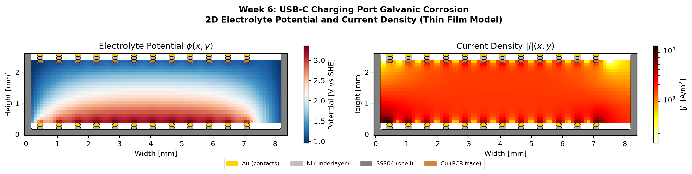
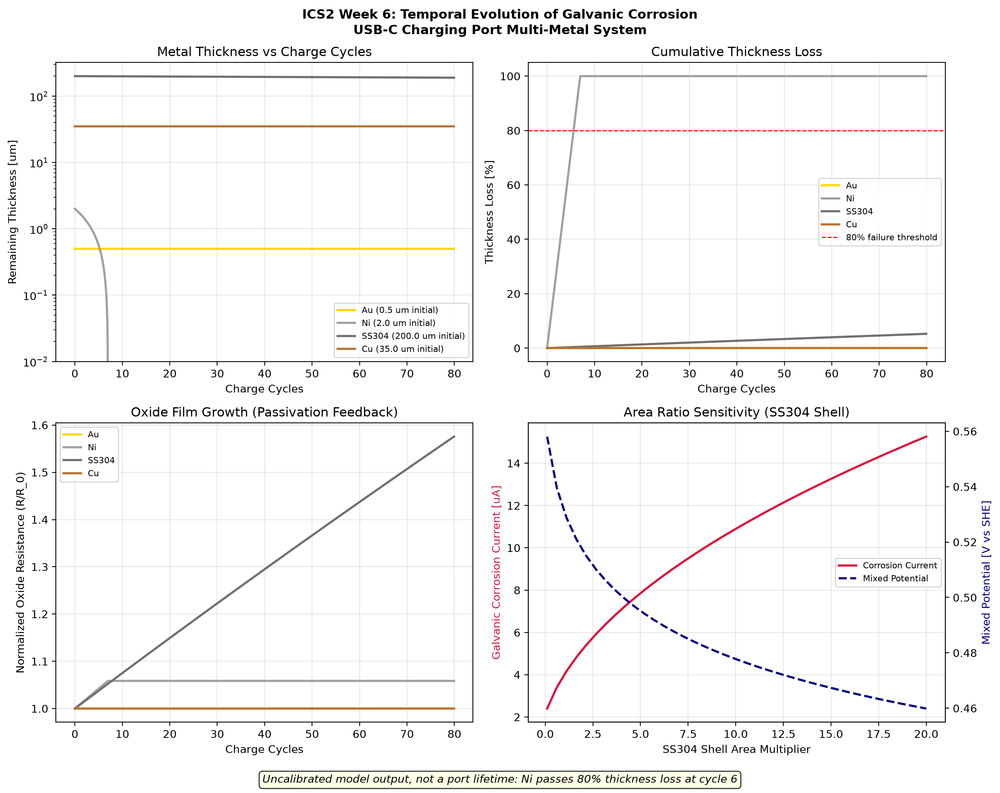
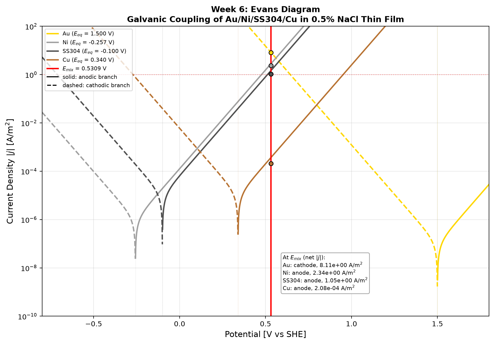
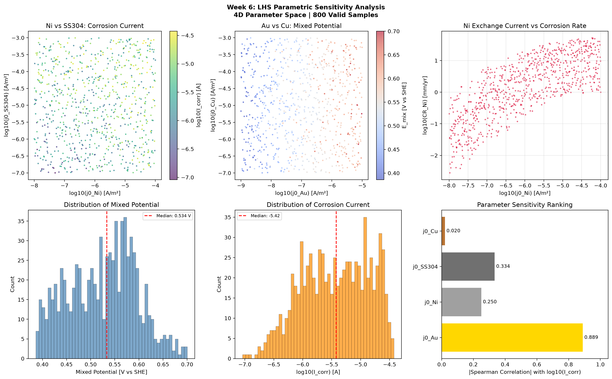
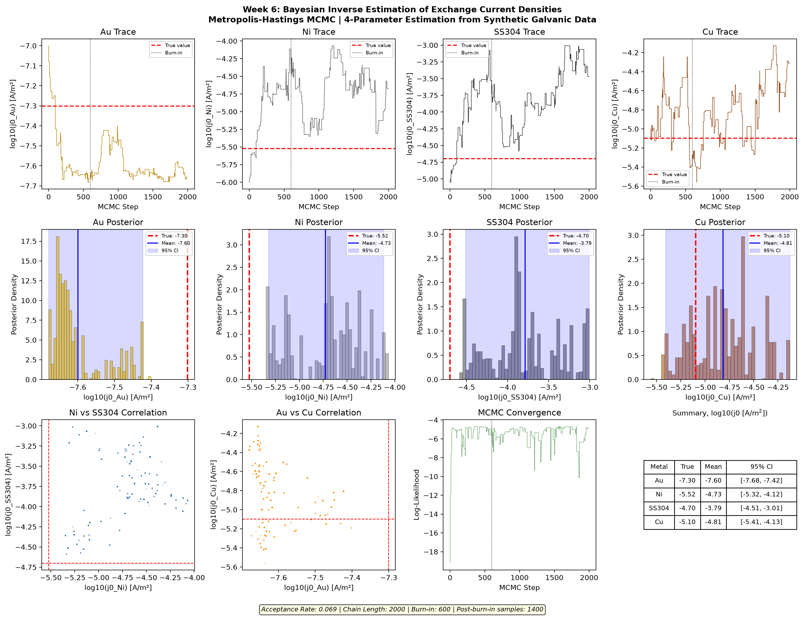

# INTEGRITY CODE SERIES - WEEK 6

**Galvanic Corrosion in Smartphone Charging Ports: Dissimilar Metal Electrochemistry with Inverse Parameter Estimation**

[](https://github.com/felipearocha/integrity-code-series-week6-smartphone-galvanic/actions/workflows/ci.yml)
[](LICENSE)
[](https://www.python.org/downloads/)
[](tests)
[](https://doi.org/10.5281/zenodo.20172479)

## Executive Summary

The USB-C charging port contains at least four dissimilar metals (Au plating on contacts,
Ni underlayer, stainless steel shell, Cu alloy traces on PCB) in a geometry where sweat,
humidity, and pocket lint create thin electrolyte films. Under charging bias, the system
becomes an unintentional electrochemical cell with spatially varying current density,
potential distribution, and material dissolution rates.

This project builds a galvanic corrosion simulator with four parts, run in sequence:
1. Macro-scale: Laplace equation for potential distribution in the thin electrolyte film
2. Micro-scale: Butler-Volmer kinetics and the mixed potential of the metal couple
3. Temporal: Faradaic dissolution and oxide film growth over charge cycles
4. Inverse: Bayesian estimation of exchange current densities from sparse synthetic galvanic current observations

Parts 2 and 3 are coupled to each other. The Laplace field is a separate result. See [Limitations](#limitations).

## Intended Use

Consumer electronics reliability research: comparing plating stacks and connector materials.
The model is uncalibrated, so it does not give a port lifetime, a warranty cost or a go/no-go
decision. Those would need measured exchange current densities and an oxygen-reduction cathode.

## Failure Consequences

Charging port corrosion can cause intermittent charging, data loss during backup,
short circuits through corroded contacts, and warranty claims.

## Results

Default run (`python run_all.py`): 5 V on the Au pins, 35 C, 0.5% NaCl proxy. All values are
outputs of an uncalibrated model.

| Output | Value |
|---|---|
| Electrolyte potential range (Laplace, 5 V bias) | 0.96 to 3.35 V |
| Peak current density in the electrolyte (Laplace, 5 V bias) | 1.20e4 A/m² |
| Mixed potential, no bias | +0.531 V vs SHE |
| Galvanic current, no bias | 4.00e-6 A |
| Corrosion rate at the mixed potential | Ni 2.52, SS304 1.21, Cu 0.0002, Au 0 mm/yr |
| First metal past 80% thickness loss | Ni, at cycle 5.6 (1 h cycles) |

The 5.6 cycle value is not a port lifetime. It follows from Au at +1.50 V being the main
cathode; see [Limitations](#limitations).









**Inverse estimation.** The chain does not recover the synthetic truth: the 95% credible
interval misses the true value for three of the four metals. The acceptance rate is 0.069.

| Metal | True log10(j0) | Posterior mean | 95% interval | Contains truth |
|---|---|---|---|---|
| Au | -7.30 | -7.60 | -7.68 to -7.42 | no |
| Ni | -5.52 | -4.73 | -5.32 to -4.12 | no |
| SS304 | -4.70 | -3.79 | -4.51 to -3.01 | no |
| Cu | -5.10 | -4.81 | -5.41 to -4.13 | yes |



`assets/corrosion_evolution.gif` is an illustrative animation of pit growth. It is not solver
output, and it shows Au eroding, which the model does not predict.

## Governing Equations

[**view the full rendered reference**](https://htmlpreview.github.io/?https://github.com/felipearocha/integrity-code-series-week6-smartphone-galvanic/blob/main/docs/equations.html)

Every equation below is grounded in standard electrochemistry; the two calibration
parameters (exchange current densities $j_0$ and the oxide-growth coefficient $\beta$)
are tagged `[ASSUMED]`. The full MathJax reference is also available at
**[docs/equations.html](docs/equations.html)**; open it in any browser.

### Scale 1: Macro (Electrolyte Domain) - Laplace Equation

In the thin electrolyte film, assuming electroneutrality and negligible convection, the
electrolyte potential satisfies current continuity:

```math
\nabla\!\cdot\!\bigl(\kappa\,\nabla\phi\bigr) \;=\; 0
```

where $\phi$ is the electrolyte potential [V] and $\kappa$ the electrolyte conductivity
[S/m]. For a thin film of thickness $\delta_e$, this reduces to a 2D problem on the port surface.

### Scale 2: Micro (Metal Interfaces) - Butler-Volmer Kinetics

At each metal surface $k$ (boundary condition for the Laplace equation), the interfacial
current density follows Butler-Volmer kinetics:

```math
j_k \;=\; j_{0,k}\left\{\exp\!\left[\frac{\alpha_{a,k}\,F\,\eta_k}{R\,T}\right] - \exp\!\left[-\frac{\alpha_{c,k}\,F\,\eta_k}{R\,T}\right]\right\}
```

with overpotential

```math
\eta_k \;=\; \phi_{\mathrm{metal},k} - \phi_{\mathrm{electrolyte}} - E_{\mathrm{eq},k}
```

where $j_{0,k}$ is the exchange current density [A/m²], $\alpha_{a,k},\alpha_{c,k}$ the
anodic/cathodic transfer coefficients, and $E_{\mathrm{eq},k}$ the equilibrium potential
of metal $k$. Constants $F = 96485$ C/mol, $R = 8.314$ J/(mol K); $T$ is temperature [K].

At a metal surface the current entering the electrolyte equals the Butler-Volmer current, with
$\phi_s$ the surface potential, $\phi_e$ the adjacent electrolyte potential and $\Delta n$ the grid spacing:

```math
\kappa\,\frac{\phi_s - \phi_e}{\Delta n} \;=\; j_k\bigl(\eta_k(\phi_s)\bigr)
```

### Scale 3: Temporal Evolution - Faradaic Mass Loss

Mass loss per unit area follows Faraday's law of electrolysis, driven by the anodic current density:

```math
\frac{\mathrm{d}m_k}{\mathrm{d}t} \;=\; \frac{M_k}{n_k\,F}\,j_{\mathrm{anodic},k}, \qquad \frac{\mathrm{d}h_k}{\mathrm{d}t} \;=\; -\frac{1}{\rho_k}\,\frac{\mathrm{d}m_k}{\mathrm{d}t}
```

with $m_k$ the mass lost per unit area [kg/m²], $h_k$ the remaining thickness [m], $M_k$ the
molar mass [kg/mol], $n_k$ the electrons transferred per atom dissolved, and $\rho_k$ the density [kg/m³].

### Oxide Film Growth (Micro-Scale Feedback)

A protective oxide film builds resistance in proportion to the anodic charge passed:

```math
R_{\mathrm{oxide},k}(t) \;=\; R_{\mathrm{oxide},0,k} \;+\; \beta_k\!\int j_{\mathrm{anodic},k}\,\mathrm{d}t
```

with $\beta_k$ the growth coefficient [Ω·m²/(C/m²)] `[ASSUMED]`. The film lowers the effective
exchange current density, which couples oxide growth to the mixed potential:

```math
j_{0,\mathrm{eff},k} \;=\; \frac{j_{0,k}}{1 + j_{0,k}\,R_{\mathrm{oxide},k}\,F/(R\,T)}
```

### Galvanic Coupling Constraint

At the mixed (couple) potential, total anodic current equals total cathodic current over
the exposed areas $A_k$:

```math
\sum_k A_k\,j_{\mathrm{anodic},k}\bigl(\phi_{\mathrm{couple}}\bigr) \;=\; \sum_k A_k\,j_{\mathrm{cathodic},k}\bigl(\phi_{\mathrm{couple}}\bigr)
```

where $A_k$ is the exposed area of metal $k$. In the code this is the root of the net current
$\sum_k A_k\,j_k = 0$ with $\eta_k = \phi_{\mathrm{couple}} - E_{\mathrm{eq},k}$ and no ohmic drop.

## Materials in the System

| Metal       | Role            | E_eq vs SHE [V] | j_0 [A/m^2] | n  | M [g/mol] | rho [kg/m^3] |
|-------------|-----------------|------------------|--------------|----|-----------|--------------|
| Au          | Contact plating | +1.50            | 1e-7         | 3  | 196.97    | 19300        |
| Ni          | Underlayer      | -0.257           | 1e-6         | 2  | 58.69     | 8908         |
| SS 304      | Shell           | -0.10            | 1e-5         | 2  | 55.85     | 7930         |
| Cu          | PCB trace       | +0.340           | 1e-5         | 2  | 63.55     | 8920         |

Note: j_0 values are assumed order-of-magnitude estimates for thin-film NaCl electrolyte.
These are the parameters targeted by the inverse estimation module.
SS 304 has no single equilibrium potential: -0.10 V is a model value `[ASSUMED]`, with the
molar mass and electron count of Fe as a proxy.

## Electrolyte Properties

Human sweat proxy: 0.5% NaCl, pH 5.5, conductivity approx 1.5 S/m.
Thin film thickness: 10-500 micrometers (depending on humidity/lint trapping).

## Boundary Conditions

- Laplace domain: 2D rectangular (8.34 mm x 2.56 mm USB-C receptacle cross section)
- Metal boundaries: Butler-Volmer flux condition (nonlinear Neumann)
- Insulator boundaries (plastic housing): zero-flux Neumann, $\partial\phi/\partial n = 0$
- Under charging bias: additional 5 V offset on the Au contact pins
- Solved by step-limited Newton on the whole grid; `converged` means a full step below the tolerance

## Assumptions (Explicit)

1. Electrolyte is dilute enough for Laplace approximation (no concentration gradients)
2. Thin film is uniform thickness (no meniscus effects)
3. Temperature is uniform at 35 C (body contact temperature)
4. No convective transport in thin film
5. Oxide films are compact and follow linear growth with charge passed
6. Au dissolution is negligible under normal conditions (included for completeness)
7. $\beta_k$ (oxide growth rate) is an assumed constitutive parameter requiring calibration

## Repository Structure

    integrity-code-series-week6-smartphone-galvanic/
    |-- README.md
    |-- requirements.txt
    |-- run_all.py                 # Runs the engine, all figures and the GIF in order
    |-- src/
    |   |-- __init__.py
    |   |-- config.py              # Material properties, geometry, simulation parameters
    |   |-- laplace_solver.py      # 2D Laplace equation FD solver with BV boundary conditions
    |   |-- butler_volmer.py       # Butler-Volmer kinetics for each metal
    |   |-- galvanic_coupling.py   # Mixed potential solver and area-ratio effects
    |   |-- temporal_evolution.py  # Faradaic dissolution and oxide growth ODE
    |   |-- inverse_bayesian.py   # Bayesian inference for j_0 estimation
    |   |-- multi_scale_engine.py # Orchestrator coupling all scales
    |   |-- cybersecurity.py      # STRIDE threat model, audit logging, sensor validation
    |-- tests/
    |   |-- test_all.py            # 43 tests: Butler-Volmer, Laplace, galvanic,
    |   |                          #   inverse, temporal, cybersecurity, integration
    |-- viz/
    |   |-- plot_potential_field.py
    |   |-- plot_current_density.py
    |   |-- plot_dissolution_map.py
    |   |-- plot_inverse_posterior.py
    |   |-- plot_parameter_sensitivity.py
    |   |-- generate_gif.py        # Illustrative animation, not solver output
    |-- assets/
    |-- docs/
    |   |-- equations.html         # rendered (MathJax) governing-equations reference

## Quick Start

    pip install -r requirements.txt
    python -m pytest tests/ -v
    python run_all.py

`run_all.py` runs these steps in order (about 5 minutes); each can also be run on its own:

    python -m src.multi_scale_engine
    python -m viz.plot_potential_field
    python -m viz.plot_current_density
    python -m viz.plot_dissolution_map
    python -m viz.plot_inverse_posterior
    python -m viz.plot_parameter_sensitivity
    python -m viz.generate_gif

## Limitations

- **No oxygen or hydrogen reaction.** Each metal has only its own dissolution/deposition
  couple. The main cathode is therefore Au at +1.50 V, although no dissolved Au is present,
  which drives the mixed potential to about +0.53 V and Ni corrosion to about 2.5 mm/yr.
  Oxygen reduction is not modelled. Corrosion rates and the cycle count at 80% loss are
  model outputs, not predictions.
- **The Laplace field is not coupled to the other parts.** It does not feed the mixed
  potential or the temporal model, so those run with no ohmic drop and no charging bias.
- **Biased field.** Each metal is held at its own equilibrium potential, with the bias added
  to Au. Metals are not electrically bonded in the solve, and at zero bias the field is
  exactly zero. Water electrolysis at 5 V is not modelled.
- **Geometry.** On the upper pins the zone map stacks Au behind Ni and Cu, so Cu faces the
  electrolyte and the bias reaches the film only through the lower Au pins. Metal areas are
  cell counts of the cross section, not measured wetted areas.
- **Inverse problem.** Each observation is one scalar current, used to estimate four exchange
  current densities, and the chain mixes poorly. Treat the posterior as a demonstration of
  the method.
- **Run lengths.** The engine runs 100 of the 500 configured cycles, 500 of 2000 LHS samples
  and 2000 of 5000 MCMC samples, for speed.

## Cybersecurity (STRIDE)

A full STRIDE threat model covers the sensor-driven corrosion-monitoring pipeline:
Spoofing (falsified sensor data), Tampering (modified `j_0` calibration), Repudiation
(denied parameter edits), Information disclosure (proprietary plating-stack extraction),
Denial of service (malformed-data flooding), and Elevation of privilege (unauthorised
prior edits). Runtime defences are a SHA-256 hash-chain audit log, sensor-envelope
validation, physical-consistency checks, and data-poisoning (leave-one-out) detection.
See `src/cybersecurity.py`.

## Source Confidence Tiers

Every equation and constant carries an explicit source tier:

- **T1 (standard / handbook):** Butler-Volmer electrode kinetics, the Laplace
  current-continuity equation, Faraday's law of electrolysis, and mixed-potential
  theory; the physical constants $F = 96485$ C/mol and $R = 8.314$ J/(mol K); and
  the material properties $E_{\mathrm{eq}}$, $M$, $n$, $\rho$ in the materials table, except SS 304.
- **T2 (derived):** the effective $j_0$ reduction from the growing oxide resistance,
  and the mixed-potential root solved from the T1 kinetics.
- **T3 / [ASSUMED]:** the exchange current densities $j_0$ (order-of-magnitude
  estimates for thin-film NaCl, the target of the inverse module), the oxide-growth
  coefficient $\beta$ (a constitutive parameter requiring calibration) and the SS 304
  equilibrium potential. The electrolyte proxy (0.5% NaCl, $\kappa \approx 1.5$ S/m) and
  the uniform-thin-film geometry are likewise modelling assumptions.

These tiers are applied honestly: where a value is a modelling assumption rather than a
handbook or physical constant it is tagged `[ASSUMED]` in the README, in
[`docs/equations.html`](docs/equations.html), and in the source, and is never presented
as a measured or standard-derived quantity.

## Disclaimer

Research tool only. Not for design, fitness-for-service, or safety-critical decisions
without site-specific calibration and independent PE review.

## License

MIT - Felipe Rocha. See [LICENSE](LICENSE).

## How to Cite

If this software contributes to your work, please cite both the software (this repository) and the underlying methods it implements.

**Software (archived release):**

> Rocha, F. (2026). *Integrity Code Series - Week 6 - Multi-Scale Galvanic Corrosion in Smartphone Charging Ports* (Version 1.0.1) [Computer software]. Zenodo. https://doi.org/10.5281/zenodo.20172479

**BibTeX:**

```bibtex
@software{rocha_2026_week6,
  author       = {Rocha, Felipe},
  title        = {{Integrity Code Series - Week 6 - Multi-Scale Galvanic Corrosion in Smartphone Charging Ports}},
  year         = 2026,
  publisher    = {Zenodo},
  version      = {v1.0.1},
  doi          = {10.5281/zenodo.20172479},
  url          = {https://doi.org/10.5281/zenodo.20172479}
}
```

The two DOIs Zenodo provides are:

| DOI                                  | What it points to                                                  |
|--------------------------------------|--------------------------------------------------------------------|
| `10.5281/zenodo.20172479` (concept)   | Always resolves to the latest version - use this for citation.     |
| `10.5281/zenodo.20172480` (version)   | Pinned to v1.0.1 specifically - use when reproducibility matters.  |

A machine-readable citation file is also available in [`CITATION.cff`](CITATION.cff) - GitHub will display a "Cite this repository" widget at the top right of the repo page that exports BibTeX / APA / RIS automatically.

## Escalation from Week 5

Week 5: 1D spatial PDE (chainage), single-phase corrosion kinetics, forward LHS sweep.
Week 6: 2D spatial PDE (Laplace in thin film), multi-metal galvanic coupling,
inverse Bayesian parameter estimation.

New dimensions: Multi-metal kinetics + inverse parameter estimation.

## Escalation Table

| Week | Topic | Key escalation |
|------|-------|---------------|
| 5 | Single-phase corrosion | 1D spatial PDE (chainage), forward LHS sweep |
| **6** | **Smartphone galvanic** | **2D Laplace thin-film + multi-metal Butler-Volmer mixed potential + inverse Bayesian j0 estimation** |

## Integrity Code Series

Part of an ongoing series of physics-first integrity simulators by Felipe Rocha:

| # | Repo | Domain |
|---|---|---|
| Week 3 | [integrity-code-series-week3-f1-lap-simulation](https://github.com/felipearocha/integrity-code-series-week3-f1-lap-simulation) | F1 lap simulation (six-state model) |
| **Week 6** | **[integrity-code-series-week6-smartphone-galvanic](https://github.com/felipearocha/integrity-code-series-week6-smartphone-galvanic)** | **Smartphone galvanic corrosion (Laplace + Butler-Volmer) — this repo** |
| Week 7 | [integrity-code-series-week7-h2-lferw](https://github.com/felipearocha/integrity-code-series-week7-h2-lferw) | LF-ERW H2 conversion (H diffusion + HA-FCG + B31.12-form MAOP) |
| Week 8 | [integrity-code-series-week8-creep-fatigue-heater](https://github.com/felipearocha/integrity-code-series-week8-creep-fatigue-heater) | Creep-fatigue 9Cr-1Mo (Norton/Omega + Coffin-Manson) |
| Week 9 | [integrity-code-series-week9-cui](https://github.com/felipearocha/integrity-code-series-week9-cui) | CUI thermohygro-electrochemical (2 PDEs + Butler-Volmer, Strang) |
| Week 10 | [integrity-code-series-week10-nnph-scc](https://github.com/felipearocha/integrity-code-series-week10-nnph-scc) | NNpHSCC full-physics (Chen-Sutherby-Xing + BS 7910) |
| Week 11 | [integrity-code-series-week11-erosion-corrosion-multiphase](https://github.com/felipearocha/integrity-code-series-week11-erosion-corrosion-multiphase) | Erosion-corrosion multiphase (NORSOK M-506 + DNV-RP-O501 + G119 + API 579) |
| Bonus | [Vibration-Accelerated-Corrosion-Coupled-Mechano-Electrochemical-Simulation](https://github.com/felipearocha/Vibration-Accelerated-Corrosion-Coupled-Mechano-Electrochemical-Simulation) | Vibration-accelerated corrosion (SDOF + Butler-Volmer + Archard) |
| Bonus | [synthetic-integrity-digital-twin-piml](https://github.com/felipearocha/synthetic-integrity-digital-twin-piml) | Physics-informed neural-network surrogate |
| Bonus | [integrity-data-foundation](https://github.com/felipearocha/integrity-data-foundation) | Engineering data validation baseline |
